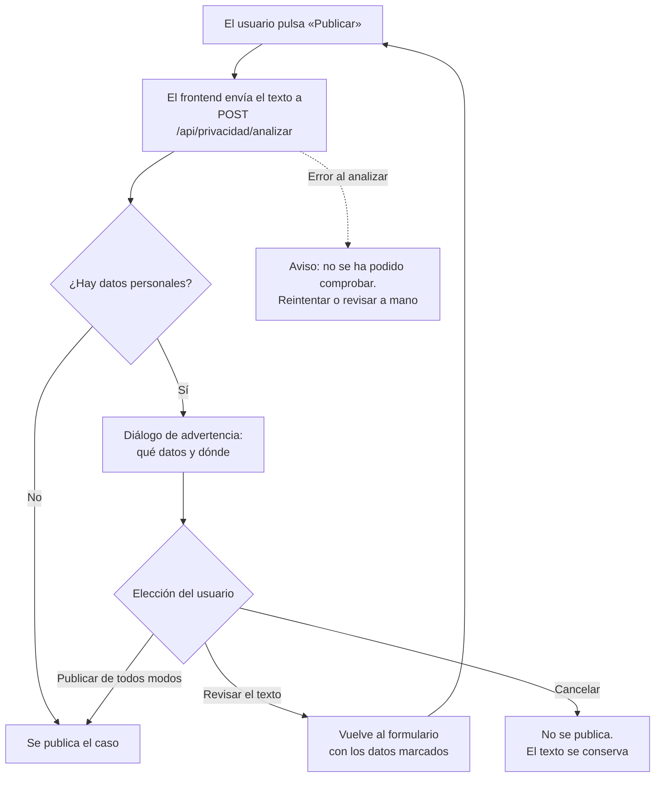

# HU-08 T3 — Flujo de advertencia previo a la publicación

**Responsable:** Juan José Soler Gordo · **Revisor:** Adrián Barranquero Ponce

Define qué pasa entre que el usuario pulsa «Publicar» y el caso se publica. Lo implementan la detección (T6) y el diálogo (T7), y lo usará el formulario de publicación de HU-02 en el Sprint 2.

## Flujo



## Reglas

1. **No se publica nada sin analizar antes** (CA1). El botón «Publicar» siempre pasa por el análisis.
2. **Si hay detecciones, la publicación se detiene hasta que el usuario elige** una opción del diálogo (CA5). Cerrar el diálogo con Escape equivale a «Revisar el texto».
3. **Si no hay detecciones, no aparece ningún aviso** (CA6) y se publica directamente.
4. **Cada vez que el texto cambia, se vuelve a analizar.** Una decisión de «Publicar de todos modos» vale solo para el texto que se analizó.
5. **Si el análisis falla** (sin conexión, error del servidor), no se publica: se avisa y se puede reintentar.

## Contrato de la API

`POST /api/privacidad/analizar` · Requiere el permiso `CASOS_PUBLICAR`.

Petición:

```json
{ "texto": "Mi DNI es 12345678Z y no lo encuentro" }
```

Respuesta 200:

```json
{
  "hayDatosSensibles": true,
  "detecciones": [
    {
      "tipo": "DNI",
      "descripcion": "DNI",
      "fragmento": "12345678Z",
      "inicio": 10,
      "fin": 19
    }
  ]
}
```

- `inicio` y `fin` son posiciones en el texto (`fin` no incluido), para marcar el fragmento en la pantalla (CA4).
- Las detecciones vienen ordenadas por su posición en el texto.
- Un texto de más de 20 000 caracteres devuelve 400.

## Contenido del diálogo

- **Título:** «Tu publicación puede contener datos personales»
- **Explicación:** «Cualquier persona podrá leer tu caso. Te recomendamos quitar estos datos antes de publicar.»
- **Lista** con cada dato detectado: tipo en lenguaje claro y fragmento.
- **El texto** con los fragmentos resaltados.
- **Botones:** «Revisar el texto» (principal, con el foco al abrir), «Publicar de todos modos» y «Cancelar».

## Para HU-02 (Sprint 2)

El endpoint de publicar también deberá analizar el texto en el servidor y rechazar la publicación si hay datos personales y la petición no indica que el usuario ha visto la advertencia. Así no se puede saltar el aviso llamando a la API directamente.
